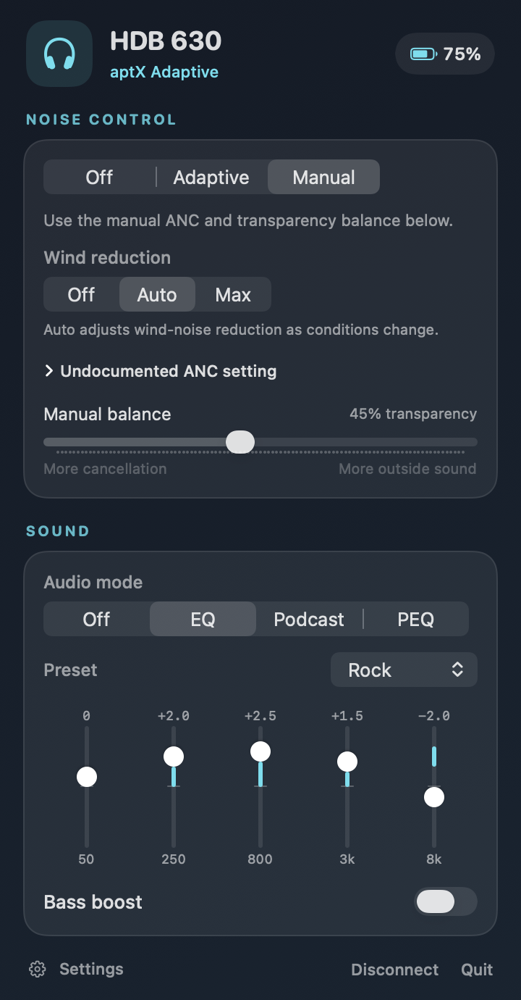
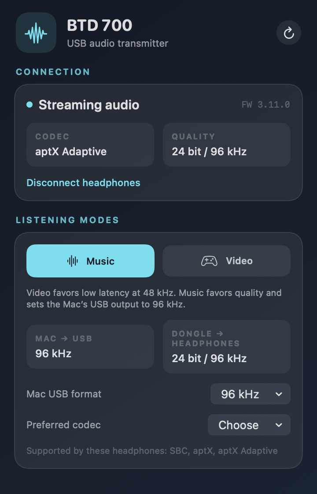
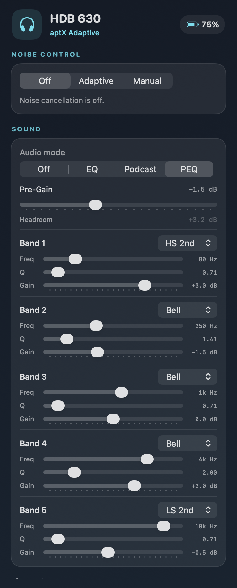
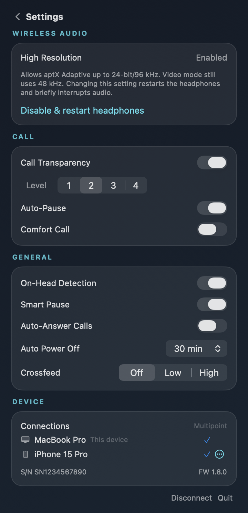

# Signal Deck

A native macOS menu bar app for Sennheiser HDB 630 headphones and the BTD 700 dongle.

Maintained independently at [steph4n-gh/signal-deck](https://github.com/steph4n-gh/signal-deck), forked from [hatemosphere/hdb630-control-macos](https://github.com/hatemosphere/hdb630-control-macos).

This personal branch adds **Control + Option + S** (`⌃⌥S`) to switch media output between the MacBook speakers and the USB BTD 700 from any app. A brief on-screen message confirms the selected output. If the dongle is unplugged, the shortcut selects the speakers. The app-settings gear also provides a switch button and shows the current output. The shortcut is active while Signal Deck is running; enable Launch at login to have it ready after signing in. Microphone selection, per-device volume, and the separate system-alert output are preserved. Development lives on `personal/audio-output-hotkey`; this fork is maintained separately from upstream.

Click the chart icon beside the Headphones and BTD 700 tabs to open **Signal Lab**. It shows the Mac-to-dongle USB audio format and timing, the dongle's Bluetooth codec, link format and transport, headphone wear state, and an RSSI history for the separate Mac-to-headphone control connection. See [the telemetry map](docs/07-signal-lab.md) for what each reading means and which raw sensors are unavailable.

**Headphones → Settings → Wireless audio** controls High Resolution directly from the Mac. Applying it restarts the headphones and restores the control connection. Music can then negotiate 24-bit/96 kHz; Video continues to use 48 kHz. [Protocol and validation](docs/09-wireless-resolution.md).

Signal Lab also decodes the headphone streaming statistics (primary RSSI, normalized link quality, codec, lossless flag and bitrate when reported), and shows experimentally mapped usage counters. All 19 vendor records are available as raw values. The [24-statistic investigation](docs/08-statistics.md) records the evidence and unresolved IDs; telemetry stays on your Mac.

<p>
  
  
  
  
  
  
</p>

## How it works

Communicates with the headphones over Bluetooth Classic RFCOMM using the GAIA v3 protocol (Qualcomm). Despite the Airoha chipset, HDB 630 speaks GAIA v3 -- discovered through reverse engineering the mobile app and Sennheiser's desktop client. BTD 700 settings use its USB HID control interface directly through macOS IOKit; no extra driver or library is needed.

Connection flow:
1. SDP discovery to find the GAIA RFCOMM channel
2. Open RFCOMM channel
3. Register for push notifications (10 Sennheiser features + 1 Qualcomm)
4. Fetch all device state
5. Real-time updates via push notifications + 2-second polling for settings without notification support

## Building

Requires macOS 14+ and Xcode 15+.

```
open HDB630Control.xcodeproj
```

Or with XcodeGen:
```
xcodegen && open HDB630Control.xcodeproj
```

Build and run. The app appears as a headphones icon in the menu bar.

For everyday use, run `./tools/install-local.sh`. It builds, signs, and installs the app in `~/Applications`, then launches it. Run it again after pulling changes. Click the gear beside the Headphones and BTD 700 tabs, then enable **Launch at login**. The setting uses macOS's native login-item service and is available even when neither device is connected. If macOS requires approval, the app shows a link to Login Items.

The **Headphones** tab requires pairing the HDB 630 directly to the Mac in System Settings > Bluetooth. This control connection can coexist with BTD 700 audio, but it occupies the headphones' second multipoint slot. The **BTD 700** tab works whenever the dongle is plugged into the Mac, even if the headphones are not paired to the Mac.

The app reconnects to a paired HDB 630 when its Mac Bluetooth connection returns, checks again after wake, and detects BTD 700 USB removal and insertion. Choosing **Disconnect** in the Headphones tab pauses automatic reconnection until you connect again or restart the app. Audio through the dongle does not depend on the Mac Bluetooth control connection.

If the headphones are already connected to both the dongle and a phone, disconnect the phone before pairing the Mac. Pairing a third active Bluetooth device may displace the dongle and interrupt audio. Once the Mac is connected, the app can open its control channel without taking another slot.

To regenerate the headphone screenshots with mock data:
```
xcodebuild -project HDB630Control.xcodeproj -scheme ScreenshotMock -configuration Debug build && \
  $(xcodebuild -project HDB630Control.xcodeproj -scheme ScreenshotMock -configuration Debug -showBuildSettings | grep -m1 BUILT_PRODUCTS_DIR | awk '{print $3}')/screenshot_mock screenshots
```

The BTD 700 screenshot shows a connected dongle running firmware 3.11.0. The app-settings screenshot was captured from the installed app with Launch at login enabled.

## Tests

Run the offline regression checks on macOS with Xcode installed:

```sh
./tools/test.sh
```

The checks compile production parsing, request-session, controller, and audio-observation code. Recorded packet responses and simulated OS calls cover cancellation, reconnect isolation, malformed replies, and listener cleanup. They do not communicate with the headphones or dongle. Native app behavior and physical connections require separate verification.

## Project Structure

```
App/
  AppDelegate.swift          -- Menu bar item, popover, polling
  HDB630ControlApp.swift     -- SwiftUI app entry point
Bluetooth/
  Models.swift               -- Shared model types (ANCState, EQPreset, etc.)
  GAIAProtocol.swift         -- GAIA v3 packet builder/parser
  BluetoothManager.swift     -- SDP lookup, RFCOMM I/O
  HeadphoneController.swift  -- Device state + all get/set commands
  DongleController.swift     -- BTD 700 USB HID control and status
UI/
  Components.swift           -- Shared UI components (CardSection)
  StatusBarView.swift        -- Main popover (controls, EQ, PEQ)
  SettingsWindow.swift       -- Settings page (call, general, device info)
  DongleView.swift           -- BTD 700 controls and status
  DiagnosticsView.swift      -- Signal Lab telemetry window

tools/
  MockController.swift         -- Mock stubs for screenshot generation
  main.swift                   -- Headless screenshot renderer
  cli_probe_commands.swift     -- CLI probe script used during RE

docs/                          -- Protocol docs and RE guide
```

## Features

**Noise Control**
- Noise-control modes: Off, Adaptive, Manual, with explanations in the app
- Anti-Wind (off/max/auto); the app explains that Max wind filtering is not maximum overall ANC
- Undocumented Comfort ANC flag under advanced controls, clearly marked as unverified acoustically
- Transparency level (0-100)

**Audio**
- Preset EQ (Neutral, Rock, Pop, Dance, Hip-Hop, Classical, Movie, Jazz) with 5-band slider gains and custom detection
- Parametric EQ (5-band PEQ with per-stage frequency, gain, Q, filter type, and pre-gain)
- Bass boost
- Podcast mode
- Crossfeed (off/low/high)
- Codec display (SBC, AAC, aptX, aptX HD, aptX Adaptive, LC3)

**Call**
- Call Transparency / sidetone (off + 4 levels)
- Auto-Pause (pause audio when Call Transparency is active)
- Comfort Call

**Settings**
- On-Head Detection (auto-disables Smart Pause, Auto-Answer, Auto Power Off when off)
- Smart Pause
- Auto-Answer Calls
- Auto Power Off (off/15m/30m/60m)

**Device Info**
- Battery level + charging status
- Firmware version, serial number
- Connected devices (multipoint, view-only)

**BTD 700**
- Live connection state, firmware, active codec, and audio quality
- Video / Music modes set both dongle transmission and Mac USB output to 48 / 96 kHz, with readback of the actual formats
- Manual Mac USB sample-rate selection (44.1, 48, or 96 kHz when offered by the dongle)
- Reconnect and disconnect controls
- Codec choices when the connected headphones expose more than one option, with rejection errors shown if the dongle declines a request

## Live validation

On an HDB 630 and BTD 700 (firmware 3.11.0), the following controls were changed, read back from the device, and restored: ANC on/off; Anti-Wind Off/Max/Auto; the undocumented Comfort flag; Adaptive ANC; transparency; call and general settings; a graphic EQ band; each parametric EQ command type; crossfeed; dongle mode; and dongle disconnect/reconnect. This confirms protocol readback, not the audible effect of every setting. The Anti-Wind values are `0=Off`, `1=Max`, `2=Auto`. Crossfeed uses `0=Low`, `1=High`, `2=Off`.

The app refreshes headset state after discrete writes and reports rejected commands. It also handles multi-stage PEQ notifications. The connected HDB 630 currently reports only aptX Adaptive as a dongle codec option, so codec switching across different headphones remains unverified. Firmware updates and Auracast broadcast configuration still use Sennheiser Dongle Control.

## Known Limitations

- Crossfeed, sidetone, auto-pause, on-head detection, smart pause, auto-answer, comfort call, and auto power off don't fire push notifications -- polled every 2 seconds while popover is open
- BTD 700 USB dongle works for audio but control still goes directly to headphones via separate BT connection
- Multipoint is intentionally view-only, to not cut own connection
- Custom EQ presets created in the mobile app show as "Custom" -- headphones only store raw band gains, preset names live in the phone app's local storage
- The dongle reports SBC, aptX and aptX Adaptive in High Quality mode; Gaming mode reported only aptX Adaptive in our tests. Codec selection requests can be rejected by firmware; the app displays that error.
- Wireless 96 kHz requires High Resolution on the headphones. Signal Deck can now read and change it under Headphones → Settings → Wireless audio, verify the write, restart the headphones and reconnect. Gaming/Video mode still uses 48 kHz. Always check the actual link format in Signal Lab.
- Packet traces use private macOS unified debug logging. The app no longer writes an unbounded `/tmp/hdb630.log` file.
- Firmware updates and Auracast broadcast configuration remain in Sennheiser Dongle Control.

## BTD 700 Dongle & Multipoint

The BTD 700 USB-C dongle appears as a standard USB audio device and a vendor HID control interface. Audio goes: Mac -> USB -> dongle -> Bluetooth -> headphones. This gives you high-quality codecs (aptX Adaptive) that aren't available over regular macOS Bluetooth.

Control (this app) connects directly to the headphones via a **separate** Bluetooth Classic connection. So if you want BTD 700 audio + this app from the same Mac, that's **both multipoint slots taken** -- no room for a third device (e.g. phone):

1. BTD 700 dongle (audio, high-quality codec)
2. Mac Bluetooth (RFCOMM control via this app)

HDB 630 supports up to 2 simultaneous connections and 3 paired devices. Without the dongle, regular Mac Bluetooth handles both audio and control over a single connection, leaving one slot free for another device.

## License

MIT

The headphone controller and UI started from [hatemosphere/hdb630-control-macos](https://github.com/hatemosphere/hdb630-control-macos). BTD 700 HID command identifiers and report layout were informed by [sobalap/btd700ctl](https://github.com/sobalap/btd700ctl).
