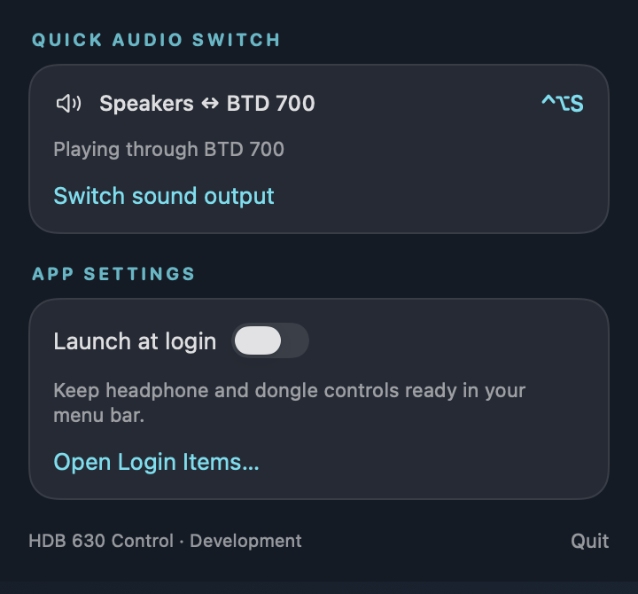

# HDB 630 macOS Controls

Native macOS menu bar app for Sennheiser HDB 630 headphones and the BTD 700 USB dongle. No Sennheiser app, phone, or extra drivers needed.

| Headphones | Parametric EQ |
| --- | --- |
|  |  |

| Headphone settings | BTD 700 | App settings |
| --- | --- | --- |
|  |  |  |

## Features

**Noise control**
- Off / Adaptive / Manual modes, with a manual ANC-to-transparency balance (0-100)
- Wind reduction (off/auto/max), shown in Manual only like Sennheiser's app (Adaptive manages it)
- Undocumented Comfort ANC flag, tucked under an advanced disclosure (write/readback verified, acoustic effect unknown)

**Sound**
- Graphic EQ: 5 bands, presets (Neutral, Rock, Pop, Dance, Hip-Hop, Classical, Movie, Jazz), custom detection, bass boost
- Parametric EQ: 5 stages (Bell / low shelf / high shelf / bypass) with frequency, Q, gain, plus pre-gain (-12..0 dB) and headroom; ranges match Sennheiser's HDB 630 config
- Podcast mode, crossfeed (off/low/high)
- Codec display (SBC, AAC, aptX, aptX HD, aptX Adaptive, LC3)

**Headphone settings**
- High Resolution (24-bit/96 kHz) toggle; applying it restarts the headphones and reconnects automatically ([details](docs/09-wireless-resolution.md))
- Call transparency (off + 4 levels), auto-pause, comfort call
- On-head detection, smart pause, auto-answer, auto power off (off/15/30/60 min)
- Battery and charging status, firmware, serial
- Paired devices: see which are connected, connect / disconnect / forget other devices (the Mac's own slot is protected)

**BTD 700**
- Connection state, firmware, active codec, link bit depth / sample rate
- Music / Video modes: set both the dongle mode and the Mac USB output rate (96 / 48 kHz), then read both back
- Manual Mac USB sample rate (44.1 / 48 / 96 kHz when offered)
- Disconnect / reconnect headphones; switch codec (e.g. aptX / aptX Adaptive) when the headphones offer more than one
- USB hotplug detection and recovery after sleep

**App**
- **Control + Option + S** switches the Mac's output between the built-in speakers and the BTD 700 from any app, with a short on-screen confirmation. Falls back to speakers if the dongle is unplugged. Microphone, per-device volume, and alert output are left alone.
- **Signal Lab** (chart icon next to the tabs): live USB audio format, dongle codec/link/transport, headphone wear state, control-link RSSI history, decoded streaming statistics and usage counters. See the [telemetry map](docs/07-signal-lab.md) and [statistics investigation](docs/08-statistics.md). Everything stays on the Mac.
- Launch at login via macOS login items
- Reconnects to the headphones when their Mac Bluetooth link comes back and after wake. **Disconnect** pauses auto-reconnect until you connect again or restart the app.

## Setup

1. Pair the HDB 630 with the Mac in System Settings > Bluetooth. The **Headphones** tab needs this connection; the **BTD 700** tab only needs the dongle plugged in.
2. Run `./tools/install-local.sh`. It builds a Release copy, signs it ad hoc, installs it to `~/Applications`, and launches it. Re-run after pulling changes.
3. Click the gear next to the tabs and enable **Launch at login** if you want it there after every login.

### Multipoint

The BTD 700 carries audio: Mac -> USB -> dongle -> Bluetooth -> headphones. That gets you aptX Adaptive, which macOS Bluetooth doesn't offer. This app talks to the headphones over a **separate** Bluetooth Classic connection from the Mac, so dongle audio plus Mac control uses **both** of the HDB 630's multipoint slots (2 active connections, 3 paired devices).

If the headphones are already connected to the dongle and a phone, disconnect the phone before pairing the Mac, otherwise the dongle may get dropped. Once the Mac is paired, the app opens its control channel without taking another slot. Without the dongle, regular Mac Bluetooth carries both audio and control over one connection.

## How it works

The headphones speak Qualcomm GAIA v3 over Bluetooth Classic RFCOMM, despite the Airoha chipset. This was found by reverse engineering the mobile app and Sennheiser's desktop client ([story](docs/04-reverse-engineering.md)).

1. SDP discovery finds the GAIA RFCOMM channel
2. Open the RFCOMM channel
3. Register for push notifications (10 Sennheiser features + 1 Qualcomm)
4. Fetch all device state
5. Live updates come from push notifications, plus 2-second polling (only while the popover is open) for settings that don't push

Requests are serialized per command, so overlapping edits (e.g. two EQ bands) queue instead of colliding. Replies from a previous connection are discarded after a reconnect.

The BTD 700 is controlled through its vendor USB HID interface via IOKit ([command map](docs/06-btd700-dongle.md)). The Mac USB sample rate and the output switch use Core Audio.

## Building

Requires macOS 14+ and Xcode 16+.

```sh
xcodegen   # optional, regenerates HDB630Control.xcodeproj from project.yml
open HDB630Control.xcodeproj
```

### Tests

```sh
./tools/test.sh
```

Offline checks compiled against the production sources: GAIA packets, the command session (FIFO, cancellation, late replies, teardown), headphone controller lifecycle, dongle status parsing, statistics parsing, and Core Audio rate observation. They use recorded responses and simulated OS calls and don't talk to real hardware.

### Screenshots

The images above are rendered from the real views with mock data:

```sh
xcodebuild -project HDB630Control.xcodeproj -scheme ScreenshotMock -configuration Debug -destination 'generic/platform=macOS' -derivedDataPath build/mock build
build/mock/Build/Products/Debug/screenshot_mock screenshots
```

## Project structure

```
App/
  AppDelegate.swift          -- Menu bar item, popover, polling, reconnect, Signal Lab window
  AudioOutputSwitcher.swift  -- Ctrl-Opt-S output switch, BTD 700 USB sample rate
  HDB630ControlApp.swift     -- SwiftUI app entry point
Bluetooth/
  Models.swift               -- Shared model types (ANCState, EQPreset, statistics, etc.)
  GAIAProtocol.swift         -- GAIA v3 packet builder/parser, command IDs
  GAIACommandSession.swift   -- GAIA framing, per-command FIFO, timeouts
  BluetoothManager.swift     -- SDP lookup, RFCOMM connection lifecycle
  HeadphoneController.swift  -- Headphone state + all get/set commands
  DongleController.swift     -- BTD 700 USB HID control and status
UI/
  Components.swift           -- Shared UI components (CardSection)
  StatusBarView.swift        -- Headphones tab (noise control, EQ, PEQ)
  SettingsWindow.swift       -- Headphone settings, app settings
  DongleView.swift           -- BTD 700 tab
  DiagnosticsView.swift      -- Signal Lab window
tools/
  test.sh, test-*.swift      -- Offline regression checks
  install-local.sh           -- Build, sign, install to ~/Applications
  MockController.swift       -- Mock controllers for screenshots
  main.swift                 -- Screenshot renderer
  cli_probe_commands.swift   -- GAIA probe script used during RE
  cli_statistics.swift       -- Dump GAIA statistics
  check-eq-persistence.sh    -- Check EQ survives a headphone reboot
docs/                        -- Protocol notes and RE write-ups
```

## Docs

- [GAIA v3 protocol](docs/01-gaia-v3-protocol.md) and [command reference](docs/02-gaia-v3-commands.md)
- [HDB 630 device config](docs/03-hdb630-device-config.md), [APK source map](docs/05-apk-source-map.md)
- [Reverse engineering write-up](docs/04-reverse-engineering.md)
- [BTD 700 HID interface](docs/06-btd700-dongle.md)
- [Signal Lab telemetry](docs/07-signal-lab.md), [statistics](docs/08-statistics.md)
- [Wireless High Resolution](docs/09-wireless-resolution.md)
- [EQ feature status](docs/10-eq-feature-status.md)

## Known limitations

- Crossfeed, sidetone, auto-pause, on-head detection, smart pause, auto-answer, comfort call, and auto power off don't send push notifications, so they're polled every 2 seconds while the popover is open
- Custom EQ presets from the mobile app show as "Custom". The headphones store only band gains; preset names live in the phone app.
- In High Quality mode the dongle reports SBC, aptX, and aptX Adaptive; Gaming mode reported only aptX Adaptive. The dongle switches to one codec at a time; there is no automatic codec choice over USB.
- 96 kHz wireless needs High Resolution enabled on the headphones and Music mode. Video always uses 48 kHz. Check the actual link format in the BTD 700 tab or Signal Lab.
- Firmware updates and Auracast broadcast setup still need Sennheiser's apps
- Settings were verified by write + readback on HDB 630 firmware 3.33.3 and BTD 700 firmware 3.11.0. That confirms the protocol, not the audible effect of every setting.

## License

MIT

BTD 700 controls, Signal Lab, and the transport rework were contributed by [steph4n-gh](https://github.com/steph4n-gh/signal-deck). BTD 700 HID command identifiers and report layout come from [sobalap/btd700ctl](https://github.com/sobalap/btd700ctl).
