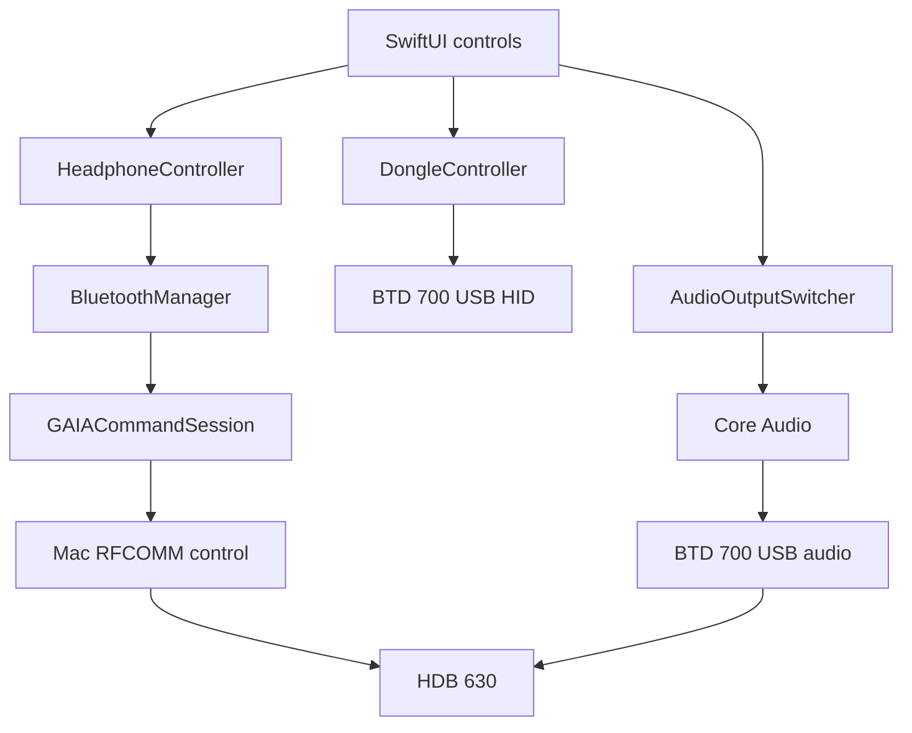

# Signal Deck review and fixes, 2026-10-15

## Scope and baseline

This review starts from `abe9d2205ac2e7d7881638b85dad062a3d5f2d3f` on `personal/audio-output-hotkey`. The checkout was clean. Review coverage includes all production Swift files, both Xcode targets, existing test and screenshot utilities, and local protocol documentation. Three independent read-only slices covered RFCOMM and GAIA, USB HID, and app/UI behavior. Implementation then received separate correctness review.

The baseline has approximately 5,400 Swift lines. It builds successfully. Its automated behavioral coverage consists of the statistics parser check. ScreenshotMock renders real views against no-op controller stubs, so it establishes appearance rather than production command or lifecycle behavior.

## Architecture and the source of the failures



`AppDelegate` owns controllers, the menu bar popover, polling, wake recovery, and diagnostics. `HeadphoneController` owns headphone settings and translates them into GAIA commands. `DongleController` controls the dongle's separate vendor HID interface. `AudioOutputSwitcher` owns the global shortcut and Core Audio routing and rate reads/writes.

Mac Bluetooth carries the separate headphone control connection. Audio can continue through the USB dongle independently. The review preserves that distinction and does not make the Mac's Bluetooth audio profile the output path.

The highest-impact baseline problems are ownership and request lifetime. Bluetooth lifecycle methods and the receive queue both mutate the same Data buffer. Pending commands are keyed only by vendor and response command. Disconnect discards callbacks, but their timers survive. Separate EQ bands also share one response key, so ordinary overlapping edits collide. Fixing individual UI buttons would leave those causes in place.

The changed manager owns lifecycle and request state on MainActor. Its existing serial queue handles blocking native writes and channel closure using immutable packet and channel captures. The production `GAIACommandSession` owns framing, per-key FIFO requests, deadlines, cancellation, and exactly-once continuation completion. Existing callers keep the async `sendCommand` API.

GAIA carries no transaction ID. After a transmitted request is canceled or times out, the session retains a response-draining entry for that key. Its late reply cannot become the reply to a newer same-key request. If no reply arrives, that key stays unavailable until reconnection, while unrelated commands continue. This favors correct attribution without reconnect loops caused by an optional getter. Queued requests retain their own deadlines.

A separate native-write admission check handles requests canceled before their queued write begins. Once native transmission is admitted, software cancellation cannot retract bytes already handed to IOBluetooth. Physical teardown can still wait behind a stalled native write.

## Prioritized findings and changes

Source positions in this table refer to the baseline commit. The production files now contain the fixes.

| Priority | Baseline evidence and failure scenario | Change |
|---|---|---|
| High | `BluetoothManager.swift:245,322`. Disconnect deletes callbacks; a surviving timer can remove a new connection's same-command callback. | Session teardown completes every waiter. Request and session identity protect later work. |
| High | `BluetoothManager.swift:293` and `HeadphoneController.swift:547,669`. Two EQ bands or PEQ stages share a command ID; the second edit is rejected while the first awaits its ACK. | Per-vendor/response-command FIFO preserves edits and retains concurrency between unrelated commands. |
| High | `BluetoothManager.swift:181,244,342,377`. Main and the receive queue mutate one buffer without isolation. | One actor owns the buffer, requests, and connection lifecycle. |
| Medium | `BluetoothManager.swift:197,201,364`. SDP startup errors are ignored, discovery has no complete-attempt timeout, and old channel data/close can affect a replacement. | Bound the attempt from discovery through open, check immediate errors, and validate attempt and channel identity on callbacks. |
| Medium | `HeadphoneController.swift:67,547,669`. Initialization and debounces survive their connection. Late replies and multi-step operations can change replacement-session state. | Own and cancel initialization/debounce tasks; validate generation and cancellation centrally and across aggregate operations. |
| Medium | `DongleController.swift:285,333`. A setter can compare its request against stale cached mode after refresh failed and authorize a USB-rate change. Short mandatory responses also look successful. | Read and validate a complete status snapshot. Refresh returns explicit success, and setters require it. Unknown modes fail explicitly. Optional failed reads become unavailable. |
| Medium | `UI/StatusBarView.swift:758` and `SettingsWindow.swift:69`. App settings Quit accesses a missing Bluetooth environment object and crashes. | Quit calls application termination directly. Existing termination cleanup owns disconnection. |
| Medium | `HeadphoneController.swift:757,765`. A reported pairing count above 256 traps when an index converts to UInt8. | Reject counts that cannot use the protocol's byte index. |
| Medium | `AudioOutputSwitcher.swift:74`. USB insertion or an external nominal-rate change leaves the dongle controls stale while speakers remain default. | Observe device-list changes and rebind a nominal-rate listener to the current dongle. Remove exactly the listeners successfully registered. |
| Low | `GAIAProtocol.swift:196`. A nonzero-index Data slice reads the wrong payload and can trap when parsing a subsequent frame. | Slice the normalized byte array already used for the header. |

Independent review added concrete regression checks. One held a bass-boost ACK across reconnection and proved an old audio-mode operation could overwrite the current error. Generation checks now cover that await. The other held native write dispatch and proved that canceled, expired, and disconnected requests could still transmit after the queue resumed. Native admission now checks the actual production request before transmission.

The small fixes follow Occam's Razor. Quit removes a dependency and delay. GAIA payload parsing changes one line. Lifecycle checks reuse existing debounce handles and generation state. The request session is the one added production component because framing, FIFO correlation, cancellation, and teardown require one owner. No new package or transport framework is added.

## Verification

Run all hardware-free checks with:

```sh
./tools/test.sh
```

The script creates a separate ignored build directory per invocation and compiles six standalone checks against production code.

| Check | Behavior covered |
|---|---|
| Statistics | Captured pages, signedness, units, empty fields, malformed records. |
| GAIA packets | Literal wire bytes, sliced Data, fragmented and concatenated frames, invalid headers. |
| Command session | Exact FIFO packets, independent vendor/command replies, errors, cancellation, enqueue deadlines, late-reply draining, teardown, replacement, stale timers/write IDs, and native admission. |
| Headphone controller | Malformed pairing count, stale replies/errors, initialization cancellation, EQ/PEQ operation boundaries, all debounce families, current-session writes, notifications, and explicit resolution restart flow. |
| Dongle status | Every short mandatory field, known and unknown modes, one/two-byte codec masks, optional failures, and cancellation before or during reads. |
| Audio observation | External rate updates, unplug/replug with a new device ID, registration retry, repeated startup, weak ownership, and cleanup. |

The command-session tests use the real production continuation bridge with a recording writer. Controller tests substitute the existing transport boundary, not the controller. Audio tests compile the actual class with simulated OS calls. Dongle tests exercise the production snapshot reader; they do not directly execute a physical setter/readback failure. These are software checks, not proof of physical radio or USB timing.

Failure-before receipts include the actual App settings Quit crash, wrong sliced GAIA payload, pairing-count conversion trap, stale audio-mode error assertion, and stale queued native-write reproduction. Logs and the decision trail are local under `build/review-2026-10-15/`. The baseline Quit crash is also recorded in `~/Library/Logs/DiagnosticReports/HDB630Control-2026-10-15-102518.ips`.

Final checks passed on the completed working tree:

- `./tools/test.sh` passed all six programs. The GAIA command session compiles in Swift 6 mode. The final run is `build/review-2026-10-15/final-offline-tests.log`.
- The Debug `HDB630Control` and `ScreenshotMock` targets both report BUILD SUCCEEDED. Their logs are `final-app-build.log` and `final-mock-build.log` in the same receipt directory. Xcode emits local CoreDevice/CoreSimulator plugin diagnostics, but those do not prevent these macOS builds.
- The real changed app read BTD 700 firmware 3.11.0 and disconnected status. The open UI followed an actual external USB rate change from 48 to 96 kHz, then back to 48 kHz. The default output stayed MacBook Pro Speakers. This validates USB nominal-rate observation, not wireless 96-kHz streaming.
- Signal Lab opened and showed actual USB and local audio values with the headphone control link marked offline.
- App settings Quit returned exit code 0 from the exact final Debug executable. `native-quit-exit.json` binds the process exit to binary SHA256 `e0c993ceadfe6dba7b72e01cca96d16b968d5a41fb0cb3a35bc5a48e06f6fccd`. Only the baseline Quit crash report existed afterward.
- UI/HID and external-rate checks predate only the final transport cancellation-signal change. Their component source stayed unchanged. Quit was repeated against the final rebuilt binary. Native QA details and the UI-inspector automatic-relaunch behavior are recorded in `build/review-2026-10-15/native-qa.md`.
- Final independent review reports no unresolved code finding in the reviewed paths. It independently rebuilt the Swift 6 command-session tests after finding and verifying the cancellation-order correction. This is an independent review using the inherited parent model, not a cross-model panel.

Final review exposed that scheduling actor cleanup from `onCancel` is insufficient at native admission. A task can already be canceled while that cleanup is still queued. The final request stores one OS-locked cancellation bit, set synchronously in `onCancel`, while all request-lane state remains MainActor-owned. Admission, FIFO advance, and response delivery check it. The manager-pattern reproduction changed from admitted true to false. The lock is never held across a callback, continuation, native call, or await.

At the source-review handoff, changes were local and uncommitted and the original installed app was restored. The installation follow-up below supersedes that delivery status. The full local decision trail is `build/review-2026-10-15/decisions.tsv`.

## Remaining work and limits

- `DongleController.command` still uses synchronous `IOHIDDeviceSetReport` on MainActor. The response timer starts afterward and cannot bound a stalled native call. This is an SDK-contract finding; a physical freeze was not reproduced. A safe native async conversion needs retained report/context lifetime and device validation.
- HID replies have a command byte but no transaction identifier. A very late same-command reply after timeout remains ambiguous. The new GAIA drain policy is not a claim that the HID transport has the same protection.
- The fallback SDP selection uses the last unknown RFCOMM service rather than proving there is exactly one candidate. Requiring a unique fallback would prevent an ambiguous connection attempt when known GAIA UUIDs are absent.
- The 96-kHz UI hint can recommend a headphone restart even when the independent Mac USB rate is still 48 kHz. It should suggest selecting the USB rate first.
- The actual RFCOMM device name and RSSI can differ from the first matching paired device when multiple matching headsets exist. Explicit selected-device identity remains a separate correction.
- The custom vertical graphic-EQ slider lacks keyboard and accessibility adjustment. This review does not claim accessibility completeness.
- An unresolved native SDP query retains one callback target because the SDK provides no cancellation or target-retention guarantee. Other uncached discovery is rejected until completion, avoiding indefinite target accumulation. A permanently hung query may require restarting the app. Cached discovery can still proceed.
- The BTD 700 was present with firmware 3.11.0, but the headphone radio link and Mac RFCOMM control were disconnected. Physical headphone settings, restart/reconnect, negotiated wireless rate, and real cable hotplug remain unverified.
- This work is a local implementation and review. It does not establish a signed/notarized release or an external clean install.


## Installed follow-up

The user authorized installation after the source review. `tools/install-local.sh` built Release, signed it locally, and replaced `/Users/sarrington/Applications/HDB630Control.app`. All source hashes matched the reviewed manifest before building. The previous app is backed up under `build/review-2026-10-15/installation/previous-app.app`.

The installed bundle matches the signed Release output byte for byte and passes strict signature verification. Its executable SHA256 is `0cf9771965b6d1e57868e9ae0108162954138423ec41fd8768f8e25c530e45b9`. Display metadata remains version 0.1.0, build 1.

The installed app passed live BTD 700 reads, external USB-rate UI updates at 48 to 96 to 48 kHz, Signal Lab rendering, and App settings Quit with a recorded exit code 0. It relaunched successfully and is left running from the installed path. The final USB rate is 48 kHz and the default output remains MacBook Pro Speakers. No new app crash report appeared. Physical headset control remains unverified because the headphone link was disconnected.

Installation receipts and the complete check summary are in `build/review-2026-10-15/installation/verification.md` and `receipt.json`. The reviewed source, regression checks, and this report accompany the installed build.

## Connection checkmark follow-up

Physical headphone restart testing exposed a stale BTD 700 connection checkmark. The startup paired-device snapshot could precede the dongle's reconnection. The controller then depended on connection notifications and never reconciled that row during ordinary UI polling. A fresh app session showed the correct state.

`HeadphoneController.pollState()` now includes the existing `fetchDeviceList()` operation. The visible popover's existing polling and Signal Lab's existing refresh calls can recover from a missed connection notification. The device-list reader retains its cancellation and connection-generation checks.

The new `missedConnectionNotifications` regression recreates a reconnect with an initially disconnected paired device. Without delivering notifications, it changes that device to connected and then disconnected. The old controller fails with `A missed connection notification left the paired-device checkmark stale`. The updated controller passes both state transitions. All six offline checks and the Release app build pass. Independent review reproduced the failure against the old controller, passed the updated controller tests, and found no actionable regression.

A locally signed Release candidate passed two physical HDB 630 restarts, first disabling High Resolution and then restoring it. Both the Mac and BTD 700 checkmarks recovered without restarting the app. Native IOBluetooth monitoring recorded connected, disconnected, and connected for each restart. The candidate process remained PID 57539 throughout both cycles. The headphones ran firmware 3.33.3 and the dongle ran firmware 3.11.0. Fresh HID reads confirmed the dongle connected with aptX Adaptive at 24 bit and 48 kHz.

High Resolution, the other recorded headphone settings, MacBook Pro Speakers output, and the dongle's 48 kHz USB format were restored. The tested candidate executable SHA256 is `8fe7f91033d61795e45d8d7e8cb24697d01d1179adbce2b126dd9f02ba361eab`. Local evidence is under `build/checkmark-fix/`, including the before-fix failure, final tests, independent review, and native connection transitions. Those raw receipts are ignored local files. This follow-up verifies the tested restart path, not physical USB hotplug, sleep and wake, every EQ setting, or audible fidelity.
